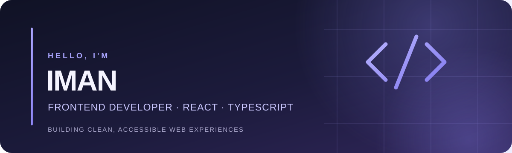

### Frontend Developer · React · TypeScript · JavaScript

Frontend developer and open-source contributor building responsive web applications, developer tools, and practical projects. Focused on React, TypeScript, JavaScript, accessibility, clean code, and maintainable UI.

Building practical, responsive web applications with a focus on clean code, accessibility, and maintainable design.

---

## ✦ Featured Project

### [CodeVault](https://github.com/CodeVault-Community/CodeVault)

A local-first code snippet manager built with React, TypeScript, and Vite.

- Create, edit, search, filter, and organize reusable snippets
- Import and export JSON backups
- Bulk selection and deletion
- Responsive interface with a refined dark theme
- Automated tests and GitHub Actions deployment

  <a href="https://CodeVault-Community.github.io/CodeVault/"><strong>↗ Explore the live demo</strong></a>

## ✦ Open-Source Contributions

I enjoy contributing to open-source projects, improving documentation, and helping make developer tools easier to use.

- **[Kunji](https://github.com/testwithsuraj/kunji)** – Working on verified model-pricing data and clearer cost information. [View my pull request](https://github.com/testwithsuraj/kunji/pull/64).
- **[Releaseproof](https://github.com/ujjwalv01/releaseproof)** – Improving documentation for reproducing past checks with a pinned Docker image digest. [View the related issue](https://github.com/ujjwalv01/releaseproof/issues/123) · [View my implementation commit](https://github.com/Iman-Rashidi/releaseproof/commit/d05a585c7bf7f1ed7bcbbdee252ac2675b288245).

I welcome constructive feedback, useful issues, and collaboration on practical developer tools.

## ✦ Tech Stack

## ✦ Learning & Achievements

**GitHub Skills – Introduction to GitHub**  
Successfully completed the hands-on GitHub Skills exercise, covering:

- Repository and branch management
- Creating commits and pull requests
- Reviewing and merging pull requests

[View the official completion confirmation](https://github.com/Iman-Rashidi/skills-introduction-to-github-2/issues/1#issuecomment-6636053957)

**GitHub Skills – Communicate using Markdown**  
Successfully completed the exercise and practiced formatting clear, structured documentation with GitHub Flavored Markdown.

[View the completed exercise](https://github.com/Iman-Rashidi/skills-communicate-using-markdown)

**GitHub Skills – Review Pull Requests**  
Successfully completed all stages of the hands-on exercise, including:

- Opening a pull request and assigning it for review
- Leaving a review and suggesting changes
- Applying suggested changes and merging a pull request

[View Mona's official completion confirmation](https://github.com/Iman-Rashidi/skills-review-pull-requests/issues/1#issuecomment-6637038152)

**GitHub Skills – Hello GitHub Actions**  

Successfully completed the hands-on exercise by creating a workflow, configuring its event trigger, job, and steps, testing it with a pull request, and merging the workflow into the default branch.

[View the completed exercise](https://github.com/Iman-Rashidi/skills-hello-github-actions) · [View Mona's official completion confirmation](https://github.com/Iman-Rashidi/skills-hello-github-actions/issues/1#issuecomment-6637395050)

## ✦ What I'm Working On

- Building original frontend applications
- Improving accessibility and responsive design
- Writing automated tests
- Learning software engineering best practices
- Exploring meaningful open-source contributions

## ✦ Collaboration

I'm interested in learning from other developers, exchanging ideas, and contributing to well-documented open-source projects.

---

*Build thoughtfully. Learn continuously. Improve every day.*

